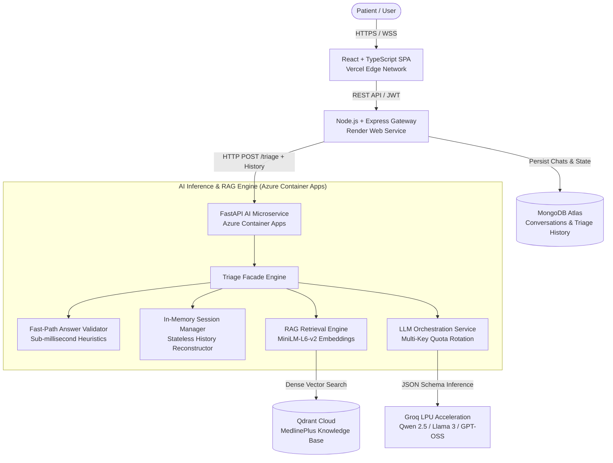
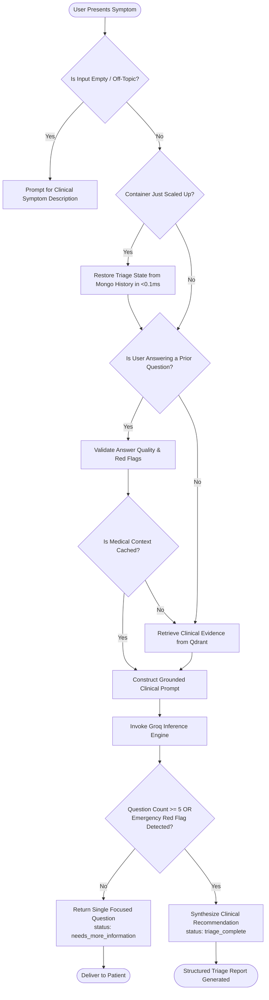

<div align="center">

# Medora AI

### Evidence-Grounded Clinical Symptom Triage & Healthcare Intelligence

<p>
  <a href="https://medora-two-inky.vercel.app/" target="_blank"></a>
  
  
  
  
  
</p>

<p align="center">
  <b>Medora AI</b> is an intelligent clinical symptom triage and healthcare intelligence platform. It leverages dense semantic vector retrieval over authoritative MedlinePlus clinical knowledge bases alongside low-latency LLM reasoning to evaluate symptom urgency, detect medical red flags, and provide structured clinical guidance through adaptive, empathetic dialogue.
</p>

</div>

---

## Overview

Traditional health assessment tools rely on rigid decision trees and static multi-page questionnaires that overwhelm users and fail to adapt to individual patient presentations. Medora AI fundamentally redesigns the clinical intake experience:

- **Adaptive Symptom Intake**: Evaluates the case dynamically turn-by-turn. It formulates exactly one focused follow-up question per turn based on established facts, avoiding compound questions and repetitive interrogations.
- **Strict Turn Bounds**: Reaches a structured clinical recommendation within 3 to 5 focused questions (maximum 5 turns), preventing fatigue and latency degradation.
- **Evidence-Grounded RAG**: Queries a high-performance vector index in Qdrant populated with verified MedlinePlus clinical topics, ensuring that potential conditions and triage rationales are grounded in medical literature rather than hallucinated.
- **Emergency Red-Flag Interception**: Instantly identifies life-threatening indicators (e.g., severe chest pressure, sudden neurological deficits, respiratory distress) to escalate risk level and halt questioning immediately.
- **Cost-Engineered Serverless Scale-to-Zero**: Operates on a multi-cloud architecture engineered for $0.00/mo operating expenditure by leveraging serverless scale-to-zero containers, sub-millisecond session reconstruction, and multi-key quota rotation.

> **Clinical Disclaimer**: Medora AI provides supportive clinical triage and risk stratification. It is not a diagnostic device and does not establish a physician-patient relationship. Patients experiencing acute or life-threatening symptoms are directed to seek immediate emergency medical care.

---

## System Architecture

Medora AI is built as a modular microservices architecture distributed across dedicated cloud platforms for optimal performance and cost isolation:



---

## Core Engineering Innovations

### 1. Zero-Latency Context Retention Across Scale-to-Zero
When hosting machine learning workloads on Azure Container Apps, instances scale to zero replicas when idle to completely eliminate compute costs. Standard in-memory Python dictionaries lose all active session state upon container shutdown.

Medora AI solves this without requiring an external Redis cache or Python-side database queries:
- The Node.js API gateway retrieves prior conversation messages from MongoDB using an indexed `conversationId` query (<2ms).
- Prior turns and their triage metadata are passed directly in the `/triage` payload as `history`.
- Upon container cold start or scale-up, the AI service reconstructs `initial_symptom`, `asked_questions`, `answered_information`, and `current_question` via a pure in-memory Python iteration in **<0.1ms**.
- Eliminates repeated embedding generation and vector search re-computation on ongoing triage turns.

### 2. Multi-Key Automatic Quota Rollover
Groq free-tier on-demand inference imposes a 200,000 Tokens-Per-Day (TPD) limit per organization:
- `llm_service.py` supports comma-separated API keys via the `GROQ_API_KEY` configuration.
- If Key 1 reaches an organization-level token limit, the engine automatically catches the `RateLimitError`, applies a key-level cooldown, and immediately retries the request using Key 2 with zero request drops.
- Once a key succeeds, the service maintains that active working index for subsequent turns to prevent unnecessary rollover overhead.

### 3. Token Reservation & Latency Optimization
- **Token Reservation Capping**: Standard LLM JSON schemas often reserve large output buffers (`max_tokens: 1200`), consuming provider quota rapidly. Medora AI caps `max_tokens` at `600`, cutting reservation overhead by 50% per turn while comfortably fitting full structured triage payloads.
- **Fast-Path Answer Validation**: Common patient responses (qualifiers, durations like "3 days", weight loss deltas like "66kg to 60kg", demographics like "50M") are validated by deterministic heuristics in **<0.1ms**, bypassing expensive LLM validator calls.
- **Context Caching**: Semantic vectors for the primary presentation are embedded and retrieved once on Turn 1 and cached across subsequent turns, reducing turn latency from ~25s to **<1.5s**.

---

## Clinical Triage Decision Flow



---

## Technical Stack

| Tier | Technologies | Responsibility | Hosting Provider |
| :--- | :--- | :--- | :--- |
| **Frontend** | React 19, TypeScript, Vite, Tailwind CSS v4, SVG Icons | Responsive patient UI, live dialogue streaming, dark/light theme | Vercel Edge Network |
| **API Gateway** | Node.js, Express, TypeScript, Mongoose, JWT | Authentication, user profile, chat history storage, route orchestration | Render |
| **Database** | MongoDB Atlas (M0 Shared Tier) | Persistent storage for users, conversations, and triage assessment payloads | MongoDB Cloud |
| **AI Microservice** | Python 3.12, FastAPI, Uvicorn, Pydantic | Clinical triage orchestration, prompt engineering, answer validation | Azure Container Apps |
| **Vector Database** | Qdrant Cloud, REST API | Dense vector indexing and similarity search over MedlinePlus corpus | Qdrant Cloud |
| **Embeddings** | `sentence-transformers/all-MiniLM-L6-v2` | 384-dimensional dense semantic embeddings computed on CPU | Pre-baked in Docker |
| **LLM Inference** | Groq LPU (`qwen/qwen3.8-27b`, `openai/gpt-oss-120b`, `openai/gpt-oss-20b`) | Structured JSON triage reasoning, evidence synthesis, risk stratification | Groq Cloud |

---

## API Specifications

### AI Service (FastAPI)

#### `POST /triage`
Processes a patient message, evaluates context, and returns the next clinical action or complete recommendation.

**Request Body:**
```json
{
  "session_id": "c3a7e58a-67a4-4a57-b2f1-c75c5f49b1a2",
  "message": "I have had a severe throbbing headache for 3 days",
  "history": [
    {
      "role": "user",
      "content": "I have a headache"
    },
    {
      "role": "assistant",
      "content": "How long have you been experiencing this headache?",
      "triage": {
        "status": "needs_more_information",
        "question_type": "duration",
        "next_question": "How long have you been experiencing this headache?"
      }
    }
  ]
}
```

**Response Payload (In Progress):**
```json
{
  "status": "needs_more_information",
  "risk_level": "unknown",
  "question_type": "severity",
  "next_question": "On a scale from 1 to 10, how severe is the headache pain?",
  "possible_conditions": [],
  "recommendation": null,
  "reason": "Pain intensity helps differentiate primary tension headaches from acute neurological emergencies.",
  "sources": []
}
```

**Response Payload (Triage Complete):**
```json
{
  "status": "triage_complete",
  "risk_level": "moderate",
  "question_type": null,
  "next_question": null,
  "possible_conditions": [
    {
      "name": "Migraine Headache",
      "evidence_ids": ["EVIDENCE 1"]
    },
    {
      "name": "Tension Headache",
      "evidence_ids": ["EVIDENCE 2"]
    }
  ],
  "recommendation": "Schedule an evaluation with your primary care provider or an urgent care clinic within 24 to 48 hours for clinical examination.",
  "reason": "Unilateral throbbing head pain lasting multiple days without acute red flags indicates a moderate primary headache presentation.",
  "sources": [
    {
      "title": "Headache - MedlinePlus Medical Encyclopedia",
      "url": "https://medlineplus.gov/ency/article/003024.htm"
    }
  ]
}
```

---

## Environment Configuration

### Frontend (`frontend/.env`)
```env
VITE_API_URL=http://localhost:5000
```

### Backend (`backend/.env`)
```env
PORT=5000
MONGO_URI=mongodb+srv://<user>:<password>@cluster.mongodb.net/medora?retryWrites=true&w=majority
JWT_SECRET=your_secure_jwt_secret_key
PYTHON_API_URL=http://127.0.0.1:8000
NODE_ENV=development
```

### AI Service (`ai-service/.env`)
```env
GROQ_API_KEY=gsk_primary_key,gsk_backup_key
QDRANT_URL=https://your-cluster-url.cloud.qdrant.io
QDRANT_API_KEY=your_qdrant_api_key
GROQ_MODEL=qwen/qwen3.8-27b
```

---

## Local Setup & Development

### Prerequisites
- Node.js 18+ and npm
- Python 3.10+ (Python 3.12 recommended)
- Git
- Access to a MongoDB instance (or free MongoDB Atlas cluster)
- Free Groq Cloud and Qdrant Cloud accounts

### 1. Clone the Repository
```bash
git clone https://github.com/AmalSumesh/Medora.git
cd Medora
```

### 2. Configure the AI Service
```bash
cd ai-service
python -m venv venv

# Windows
venv\Scripts\activate
# Linux/macOS
source venv/bin/activate

pip install -r requirements.txt
# Populate ai-service/.env with your credentials
uvicorn main:app --reload --port 8000
```

### 3. Configure the Backend API
```bash
cd ../backend
npm install
# Populate backend/.env with your credentials
npm run dev
```

### 4. Configure the Frontend UI
```bash
cd ../frontend
npm install
npm run dev
```
The application will be running locally at `http://localhost:5173`.

---

## Multi-Cloud Deployment Guide

### 1. AI Service Container (Azure Container Apps)
The repository contains an automated GitHub Actions pipeline in `.github/workflows/ai-service.yml` that builds and publishes a Docker image to GitHub Container Registry (GHCR):
```bash
# Workflow outputs:
ghcr.io/<your-username>/medora/medora-ai:latest
```
1. Deploy an **Azure Container App** on the Serverless Consumption profile.
2. In **Scale and Replicas**, set **Min Replicas = 0** and **Max Replicas = 1**.
3. Supply `GROQ_API_KEY`, `QDRANT_URL`, and `QDRANT_API_KEY` under **Secrets & Environment Variables**.

### 2. Backend Gateway (Render)
1. Create a new **Web Service** on Render connected to your repository.
2. Root Directory: `backend`
3. Build Command: `npm install && npm run build`
4. Start Command: `npm start`
5. Set `PYTHON_API_URL` to your Azure Container App's HTTPS ingress URL.

### 3. Frontend Web App (Vercel)
1. Import the repository into Vercel.
2. Root Directory: `frontend`
3. Framework Preset: `Vite`
4. Environment Variables: Set `VITE_API_URL` to your Render backend API URL.

---

## License

This project is licensed under the MIT License. See the [LICENSE](LICENSE) file for full details.
